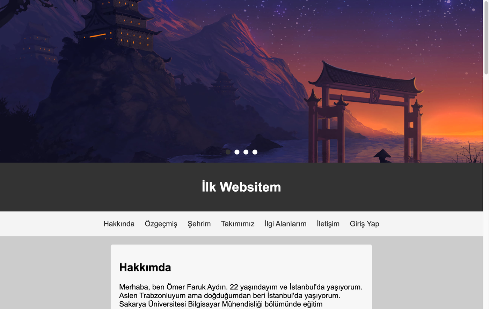

# My First Website

The first website I built: a personal site about me and my home town, Trabzon.

HTML · CSS · Bootstrap · JavaScript · Vue.js · PHP

| Page | What is on it |
|---|---|
| Hakkında | About me, my interests and photos |
| Özgeçmiş | A CV page written with semantic HTML |
| Şehrim | Trabzon, with an image slider whose slides link to short articles |
| Takımımız | Trabzonspor |
| İlgi Alanlarım | Data loaded from a free public API |
| İletişim | A contact form checked with plain JavaScript and with Vue.js, shown on a second page after sending |
| Giriş Yap | A login form checked on the page and then by a PHP script |

The pages are responsive and built without a ready-made theme. Open `memleketim-web/index.html` in a browser to see them; the login and form result pages need a PHP server, for example `php -S localhost:8000` inside `memleketim-web`.

Made for the Web Technologies course at Sakarya University, spring 2023.
